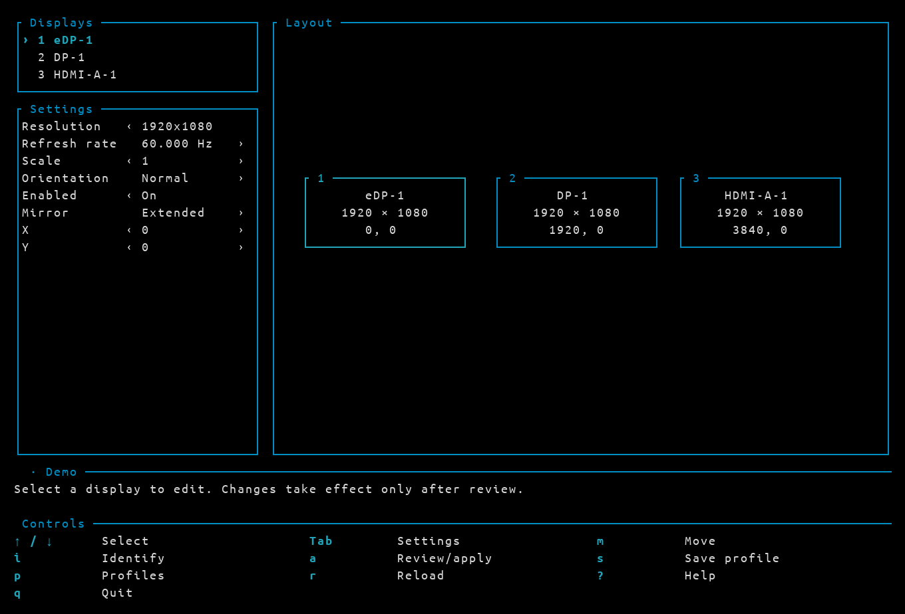
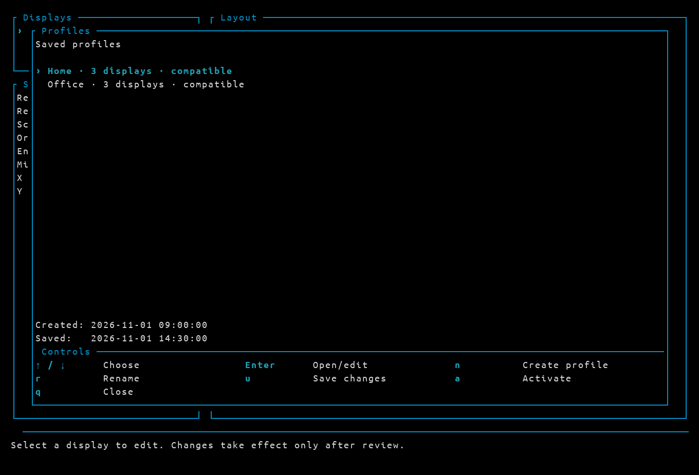

# hypr-monitor-tui

[](https://github.com/rcalvom/hypr-monitor-tui/actions/workflows/ci.yml)
[](LICENSE)

A Rust terminal user interface for configuring monitors on Hyprland.

Discover connected displays, arrange an extended desktop, mirror one display
onto another, and adjust display modes through a keyboard-driven interface.

## Screenshots

### Layout editor



### Profile manager



These images render actual TUI output captured through a pseudo-terminal, using
synthetic monitors and isolated example profiles. Colors depend on the terminal
palette; the captures use a blue/cyan palette and UbuntuMono Nerd Font.

## Project status

Initial implementation. Runtime application targets **Hyprland 0.57.x**, using
its Lua monitor API. Other versions are rejected for apply until verified.

Implemented: discovery, keyboard layout editing, optional mouse dragging,
resolution/refresh/scale/orientation, enable/disable, mirroring, display-number
overlays, timed rollback, and named profile export/import.

Not yet implemented: advanced HDR/VRR/bit-depth controls, automatic profile
switching, automatic installation into compositor startup, and the future
control-panel integration. Multi-monitor runtime changes still need hardware
validation; automated tests use a simulated compositor.

See [the initial requirements](docs/requirements.md) for scope, interaction,
safety constraints, and the proposed implementation milestones.

## Build and run

Requires a current stable Rust/Cargo toolchain, a C linker, the Cairo system
library, and a terminal. Real output discovery requires `hyprctl` and an active
Hyprland session. On Arch Linux, the relevant build packages are `rust` (or a
Rust toolchain managed by `rustup`), `base-devel`, and `cairo`. Python 3 is needed
only for the process tests. No root privileges are required to run the app.
Cargo downloads the locked Rust dependencies on the first build.

```sh
cargo build --locked
./target/debug/hypr-monitor-tui

# Read-only discovery; no display serial numbers in the JSON.
./target/debug/hypr-monitor-tui --list

# Three synthetic monitors; never changes real outputs or saves profiles.
./target/debug/hypr-monitor-tui --demo
```

For an optimized binary, use `cargo build --release --locked`, then run
`./target/release/hypr-monitor-tui`. No installation or autostart changes are
performed by the build.

## Controls

Use a terminal of at least 72 columns by 22 rows (110 × 34 is recommended).

| Key / action | Behavior |
| --- | --- |
| Arrow keys in monitor list | Select a monitor |
| Tab | Switch between monitor list and properties |
| Up/Down in properties | Select a property |
| Left/Right in properties | Move to the previous/next supported choice or adjust a value |
| Click a setting | Select it without opening a dialog |
| Enter on scale/X/Y | Edit the exact value directly in its row |
| Type a number while scale/X/Y is selected | Start entering a replacement value |
| Ctrl+U in a value editor | Clear the input; Enter accepts, Escape cancels |
| `m` | Toggle monitor movement mode |
| Arrow keys in movement mode | Move by 10 logical pixels |
| Shift + arrow / Ctrl + arrow | Move by 100 / 1 logical pixels |
| Tab in movement mode | Select a reference monitor |
| `h` / `l` / `k` / `j` in movement mode | Place left / right / above / below the reference |
| `c` / `v` in movement mode | Align vertical / horizontal centers with the reference |
| `n` in movement mode | Snap nearby edges/centers within 30 logical pixels |
| Escape | Leave movement mode, cancel a dialog, or revert a preview |
| Click and drag a monitor box | Move it in the draft diagram; snap on release |
| Click a display, setting, arrow, button, or action | Select/edit/activate it |
| Mouse wheel over Settings or a choice list | Scroll the selection |
| `i` | Show output-number overlays for 3 seconds; press again to dismiss |
| `a`, then `y` | Review all changes and apply a temporary preview |
| Enter during preview | Keep the layout after successful readback |
| `s` | Save a named profile; reuse its name to update it |
| `p` / `o` | Open the profile manager with a clickable key guide |
| `r` | Reload compositor state, discarding draft edits |
| `?` | Open help |
| `q` / Ctrl+C in the main view | Quit (prompts when a draft is modified) |
| `q` / Escape in a dialog or movement mode | Close/cancel the current view or finish moving |

The mirror property offers **Extended** and eligible independent
outputs. To duplicate an output, enable it and select another monitor as its
source. Resolution and refresh choices stay paired with reported modes.
Scale values that produce non-integral logical sizes are rejected on apply.

The interface inherits the terminal background and foreground, with ANSI blue
borders and ANSI cyan selection. TUI color roles are centralized in `src/theme.rs`
and follow the terminal palette rather than fixed RGB values.
The terminal/window title is **Hypr Monitor
TUI**, restored on exit in terminals supporting the xterm title stack. There is
no application heading inside the TUI. Thick panel borders frame the content,
and a lower state strip separates feedback from a responsive,
aligned shortcut grid. Small terminals show a centered resize card with current
and minimum dimensions. The arrangement has visual margins
and gutters without changing actual desktop coordinates.

Settings show direction arrows only when another value exists in that direction.
Resolution and refresh choices are ordered from smaller to larger; lists stop at
their endpoints rather than wrapping. A single supported refresh rate has no
arrows. The layout diagram is labeled **Layout**.

Hyprland does not require a Windows-style primary monitor to extend or mirror
outputs. Focused monitors and workspace placement rules serve different purposes;
this editor configures outputs, not default application/workspace placement.

Only independent active outputs receive their own overlay. A mirrored screen
may repeat its source's number, and a disabled screen cannot display a number.
The overlay is a small Wayland layer-shell helper in the same executable; it
does not take focus or intercept input. Its antialiased labels use the system
Cairo library and UbuntuMono Nerd Font, configured in `src/theme.rs`. Cairo must
be available when building and running the application; the font must be installed
to avoid system font fallback. Labels have an 80%-opaque black background and
read the active border color (first gradient stop) and width from Hyprland when
identification starts. Terminal mouse support depends on the
terminal/multiplexer; all configuration is available using the keyboard.

## Apply and rollback

Edits do not affect the compositor until reviewed and explicitly applied.
An independent process holds an apply lock, checks for external changes, captures
the original basic layout, applies independent outputs before mirrors and
disables outputs last, then verifies compositor readback.

After application, **Enter confirms within 15 seconds**. Escape, cancellation,
loss of the TUI's connection, timeout, or an apply/readback failure initiates
recovery. If a monitor disappears, recovery uses still-connected outputs; an
emergency fallback tries to enable one output if the previous arrangement can
no longer be restored. Errors are reported instead of claiming recovery worked.

The guard does not depend on terminal focus or the TUI event loop. It cannot
recover a crashed compositor, terminated user session, or powered-off machine.
Recovery covers the basic settings this application edits, not workspace/window
placement or advanced monitor policies. In Hyprland 0.57, `hl.monitor` retains
unspecified fields of an existing rule with the exact same output selector;
advanced rules using wildcard/description selectors need separate validation
before using this initial version with them.

Changes from other monitor tools or hotplug mark the draft stale. Refresh before
applying it. Existing desktop display-profile services can override these runtime
changes; coordinate those services before configuring persistent layouts.

## Profiles and persistence

`s` saves `<name>.json` plus a generated `<name>.lua` fragment under
`${XDG_CONFIG_HOME:-~/.config}/hypr-monitor-tui/profiles/`. Existing files receive
`.bak` copies before replacement. Names support Unicode letters, digits, spaces,
`_`, and `-` (up to 80 UTF-8 bytes), such as `Casa` or `Oficina principal`.
Version 2 JSON stores the name and UTC creation/update timestamps; version 1
profiles remain readable. The browser shows display count, compatibility and
dates for the selected profile. Saving an existing name preserves its creation
date and updates its saved date. Profiles persist across application restarts.

`p`/`o` opens the browser; select a profile and press Enter to load it as a draft.
`--profile NAME` also loads a draft. Connector and
model identities must match the current topology; profiles do not silently guess
how identical monitors moved to other connectors should map.

The manager provides these actions (letter shortcuts are lowercase):

- **Create** (`n`): name and save the current draft as a new profile.
- **Open/edit** (Enter): load the selected profile into Settings for editing.
- **Rename** (`r`): change its name, preserving settings and creation date.
- **Save changes** (`u`): update the selected profile with your draft; open it
  for editing first. You can also press `s` from the editor to save.
- **Activate** (`a`): load the saved profile and open the guarded apply review;
  confirm the preview within 15 seconds to keep it.
- **Close** (`q` or Escape): return to the editor. The guide displays only `q`.

Actions appear in a Controls section inside the profile window, below the list,
using the same grid, colors and lowercase shortcuts as the main TUI. The labels
are clickable; profile dialogs do not duplicate them as bracketed buttons.
Dialogs also accept Escape wherever `q` closes or cancels them. In naming
dialogs, `q` is reserved for cancelling rather than entering text.
Creating, saving and renaming return to the manager with the profile selected.
Names already in use are rejected when creating or renaming. Errors stay visible
below the dialog. The shortcut footer adapts to the terminal width and uses only
the rows it needs.

Saving **does not activate startup persistence** or overwrite `hyprland.lua`.
The generated Lua fragment uses `hl.monitor` and can be explicitly integrated
into a compatible configuration after testing. Automatic startup integration is
deferred because existing display managers/helpers may conflict. A freshly
started session loading the fragment has not yet been validated.

## Stack

- Rust.
- Ratatui and Crossterm for the terminal interface.
- Serde for structured Hyprland monitor data.
- Wayland client and layer-shell bindings for identification overlays.
- A Hyprland-specific backend, isolated from the UI and arrangement model.

The first release targets Linux with an active Hyprland session. Other Wayland
compositors and X11 are outside its initial scope.

## Core workflow

1. Detect connected monitors and their supported modes.
2. Edit a draft layout without immediately changing the desktop.
3. Preview and validate the layout.
4. Apply temporarily and confirm that the result is usable.
5. Revert automatically if confirmation does not arrive in time.
6. Save explicitly for future sessions when persistence is supported.

## Verification

```sh
cargo fmt --check
cargo clippy --locked --all-targets -- -D warnings
cargo test --locked
cargo build --locked
python3 tests/process-smoke.py
```

Unit tests cover layout geometry, mode validation, mirror constraints, stale
state, rollback decisions, keyboard editing, mouse dragging, and compact terminal
rendering. The process smoke test uses a private fake `hyprctl` to test actual
guard confirmation, cancellation, lost input, a real 15-second timeout, apply
failure, and concurrent transactions. It also exercises the TUI through a PTY
and checks terminal restoration. These tests never apply real display changes.

Host checks verified read-only discovery on Hyprland 0.57.0 and a short-lived
identification overlay on one output, with unchanged keyboard focus and display
configuration. Physical multi-output apply, mirroring, hotplug recovery, and
persistent session startup remain unverified.

GitHub Actions runs formatting, Clippy, unit tests, process/PTY tests and a release
build on pushes to `main` and pull requests. CI uses a simulated compositor and
requires no running Hyprland session.

To regenerate the screenshots, build the release binary and run
`python3 tests/capture-screenshots.py`. This optional helper requires Pillow and
fontconfig (`python-pillow` and `fontconfig` on Arch Linux). It uses temporary
configuration and a fake compositor, without reading personal display profiles.

## License

Licensed under the [MIT License](LICENSE).
